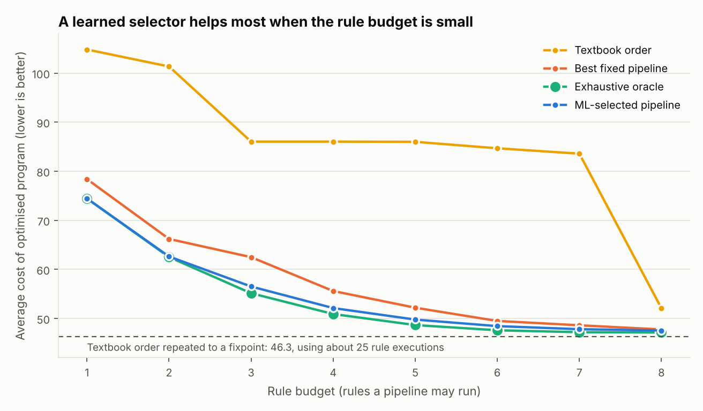

# Peephole Parley

*A conversation between compiler rules, and a model that decides who speaks first.*

**Peephole Parley** is an ML-guided peephole optimizer for three-address code. Under a compile-time budget it chooses which of eight rewrite rules to run, and in what order, for each program. An exact dynamic-programming oracle supplies the ground truth, and every optimized program is checked for identical behaviour.

Course project for BCSE307P Compiler Design Lab, VIT. Author: Savir Ghai (24BCT0309).

The optimizer works on three-address code (TAC), and a machine-learning
model decides **which optimization rules to run, and in what order**, for each
program. Built from scratch in Python (scikit-learn, NumPy, matplotlib).

## The idea in one paragraph

A peephole optimizer rewrites small windows of instructions into cheaper ones
(`x * 8` becomes `x << 3`, `t = 2 + 3` becomes `t = 5`, and so on). Compilers
run their rules in a fixed order. But the order changes the result: strength
reduction run *before* reassociation turns `(a*2)*4` into two shifts, while
running it *after* gives a single shift. This project measures that
**phase-ordering effect**, then trains a model that looks at a program and picks
a rule pipeline for it, comparing against the best fixed pipeline and against
exhaustive search.

## Quick start

```bash
pip install numpy scikit-learn matplotlib joblib      # Python 3.10+
python main.py examples/demo_large.tac --budget 4 --strategy all
python -m unittest discover -s tests                  # 22 tests, about 10 seconds
python run_all.py                                     # rebuild everything, about 10 minutes
```

Optimize your own file (TAC syntax is described at the top of `tac.py`):

```bash
python main.py prog.tac --budget 4 --strategy ml -o prog_opt.tac
```

## Headline numbers

On 400 programs the model never saw, a Ridge regressor that predicts each pipeline's regret beats the best fixed pipeline at every budget (B = 1 to 8). It saves 3.95 cost units at B = 1 and 5.98 at B = 3, and closes 68% to 100% of the gap to the oracle for B up to 5. At B = 8 the gain is 0.21. None of the 3,200 optimized programs changed behaviour.

## What is in the box

| File | Purpose |
|---|---|
| `tac.py` | TAC instruction model, parser, printer |
| `cost.py` | Static cost model (mul = 4, div/mod = 8, add/sub/and = 2, shift = 1, copy = 1, ...) |
| `interpreter.py` | Runs TAC so optimizations can be checked for identical behaviour |
| `rules.py` | The 8 peephole rules (window of 6 instructions, never across a label or jump) |
| `engine.py` | Applies rules and pipelines; exhaustive search over all rule sequences (dynamic programming) |
| `generator.py` | Random program generator (structured) and a dense fuzz generator (for testing) |
| `features.py` | 58 features: 33 structural counts plus 25 cheap probes of each rule |
| `dataset.py` | Builds training/test data, the pipeline portfolio, labels, oracle |
| `train.py` | Compares 9 models with 5-fold cross-validation, saves the winner |
| `evaluate.py` | Held-out test evaluation, behaviour check, charts and tables |
| `main.py` | Command-line optimizer |
| `tests/test_all.py` | Unit tests, randomised equivalence tests, fuzz tests, oracle check |

### The eight rules

| | Rule | Example |
|---|---|---|
| CF | constant folding | `t = 2 + 3` -> `t = 5`; `if 1 < 2 goto L` -> `goto L` |
| AS | algebraic simplification | `x * 1`, `x + 0`, `x - x`, `x * 0` |
| SR | strength reduction | `x * 8` -> `x << 3`; `x / 8` -> `x >> 3`; `x % 8` -> `x & 7` |
| CP | copy / constant propagation | `y = x; z = y + 1` -> `z = x + 1` |
| RA | reassociation | `t = x + 3; u = t + 5` -> `u = x + 8` (also `*` chains) |
| CSE | common sub-expression | `t = a + b; ...; u = a + b` -> `u = t` |
| RS | redundant statements | `x = x`, `a = b; b = a`, jump to the next line, exact repeats |
| DCE | dead code | unused temporaries, overwritten stores, code after `goto` |

Each rule is run to its own fixed point; a **pipeline** runs distinct rules once
each, in sequence. A **budget** `B` limits a pipeline to `B` of the 8 rules, so
choosing a pipeline means choosing *which* rules to run as well as their order.
Budget 8 means every rule runs and only the order matters.

### How the model is trained

1. Generate 1,600 training and 400 test programs from disjoint seeds.
2. Evaluate every candidate pipeline on every training program (all of them when
   there are at most 2,500, otherwise a random sample of 2,500).
3. Pick the **best fixed pipeline** (lowest average training cost) and a
   **portfolio** of 16 pipelines (greedy selection) so that taking the best
   member per program loses almost nothing. These are the model's choices.
4. Extract features, then compare 5 classifiers (predict the best pipeline) and
   4 regressors (predict each pipeline's *regret*, pick the smallest) by 5-fold
   cross-validation on the training set. The test set is untouched until the end.
5. Evaluate the winner on the test set against all baselines and the
   **exhaustive oracle** (best of all sequences, found by dynamic programming,
   which is exact, not sampled).

## Results (400 held-out test programs, average cost, lower is better)



| Budget | None | Textbook | Best fixed | ML-selected | Oracle | ML vs fixed (95% CI) | Headroom recovered | Behaviour check |
|---|---|---|---|---|---|---|---|---|
| 1 | 106.5 | 104.8 | 78.39 | 74.44 | 74.44 | +3.95 [+3.22, +4.72] | 100% | 0 failures / 400 |
| 2 | 106.5 | 101.3 | 66.20 | 62.62 | 62.51 | +3.58 [+2.89, +4.37] | 97% | 0 failures / 400 |
| 3 | 106.5 | 86.0 | 62.49 | 56.51 | 55.15 | +5.98 [+5.11, +6.95] | 81% | 0 failures / 400 |
| 4 | 106.5 | 86.0 | 55.59 | 52.12 | 50.91 | +3.47 [+2.93, +4.01] | 74% | 0 failures / 400 |
| 5 | 106.5 | 86.0 | 52.19 | 49.77 | 48.66 | +2.42 [+2.09, +2.75] | 68% | 0 failures / 400 |
| 6 | 106.5 | 84.7 | 49.49 | 48.44 | 47.59 | +1.05 [+0.90, +1.23] | 56% | 0 failures / 400 |
| 7 | 106.5 | 83.6 | 48.61 | 47.81 | 47.20 | +0.80 [+0.65, +0.95] | 57% | 0 failures / 400 |
| 8 | 106.5 | 52.1 | 47.76 | 47.55 | 47.14 | +0.21 [+0.14, +0.29] | 34% | 0 failures / 400 |

"ML vs fixed" is the average cost the model saves per program compared with the
best fixed pipeline (positive = better); the interval is a bootstrap over test
programs. "Headroom recovered" is that saving divided by the gap between the best
fixed pipeline and the oracle.

### What the results say

1. **Rule order matters a lot in a single pass.** With all 8 rules, the
   textbook order averages cost 52.1, the best order 47.1, the worst 61.1.
   For 94% of programs the best and worst of the 40,320 orderings differ (by 14
   cost units on average, 83 at most).
2. **But a well-chosen fixed order is already close to optimal.** At budget 8
   the best fixed pipeline is only 0.6 cost units (1.3%) above the per-program
   oracle, so the model can recover only a little (0.21 units, 34% of the
   headroom). The gain is statistically clear but small.
3. **Adaptive selection matters when rules are scarce.** At budgets 1 to 5 the
   model recovers 68% to 100% of the headroom; at budget 3 it lowers the average
   cost from 62.5 to 56.5 (about 10%). With a compile-time limit, *which* rules
   to run depends on the program, and that is what the model learns.
4. **Repeating rules beats any single pass, at a price.** Running the textbook
   order repeatedly until nothing changes reaches 46.3, better than even the
   single-pass oracle at budget 8 (47.1), but takes about 25 rule executions
   instead of 8. Model-selected pipelines give up some quality for far less work.
5. **Simple models win.** Ridge regression on predicted regret is best at
   budgets 1 to 7; a random forest regressor is best at budget 8 (the margin
   there is tiny). Regression beat classification because many pipelines tie
   for best. Syntactic counts alone give almost the same result as adding the
   rule probes (50.77 vs 50.44 at budget 4, cross-validated).

All numbers come from `results/summary_all.json`; per-model comparisons are in
`results/model_comparison_b*_full.json`, an interpretable depth-4 tree is in
`results/decision_tree_b*_full.txt`, and concrete before/after programs where
the best fixed pipeline falls short are in `results/phase_ordering_examples_b4.txt`
and `_b8.txt`.

## Correctness

* Every rule is tested against the interpreter on 250 structured programs and
  1,200 dense fuzz programs, with random initial values for every variable
  (temporaries included). No rule may change the printed output or raise cost.
* 1,500 random rule orderings and 40 exhaustive-oracle results are checked the same way.
* The exhaustive search is checked against brute force over all 40,320 orderings on a small test program.
* The fuzz tests were validated by deliberately breaking two rules; both bugs are caught.
* Every ML-chosen pipeline on all 3,200 test runs (400 programs x 8 budgets)
  produced code with identical behaviour.

## Limitations (read before citing the numbers)

* **Synthetic programs.** The programs come from a random generator built out of
  common code patterns, not from a real compiler front end. Results show the
  method works on this distribution; they are not a claim about real software.
* **Static cost model.** "Cost" is a weighted instruction count, not measured
  run time.
* **Budget experiment added after a first look.** The original plan only used
  all 8 rules. A first look showed little headroom there, so I added the budget
  study. All budgets 1 to 8 are reported, not just favourable ones.
* **Single dataset split and seed.** Confidence intervals reflect which test
  programs were drawn, not different training runs.
* **Conservative rules.** Rules look at a window of 6 instructions and stop at
  labels and jumps; ordinary variables are assumed live at the end of a segment;
  jumps only go forward (no loops).
* **The model only chooses among 16 pipelines.** This costs almost nothing
  (on the test programs the best portfolio member is within 0.4 cost units of the
  exhaustive oracle at every budget, 0.37 at most) but it is a restriction.
* **Hyper-parameters were fixed, not tuned.** A search would likely help slightly.


## Dashboard (runs locally)

```bash
python dashboard/server.py          # then open http://127.0.0.1:8765
```

The dashboard has a live workbench, where you paste three-address code (or pick an example or a random program), choose the rule budget, and watch the model's pipeline run rule by rule, with the optimized code and a comparison against the best fixed pipeline, the oracle, the textbook order and repeat-until-stable. Below it are the results charts (with a table view), the nine-model comparison, the 16 pipelines the model chooses from, and the safety numbers. It needs no extra packages and only listens on 127.0.0.1. Fonts load from Google Fonts when online and fall back to system fonts offline.

## Repository layout

```
main.py  run_all.py            command line and full rebuild
tac.py cost.py interpreter.py  language, cost model, executor
rules.py engine.py             the 8 rules, pipelines, exact oracle
generator.py features.py       programs and the 58 features
dataset.py train.py evaluate.py data, 9-model comparison, evaluation
examples/                      demo_chain.tac, demo_large.tac
data/ models/ results/         portfolios and datasets, trained models, tables and charts
dashboard/                     local web dashboard (server.py, static/)
tests/test_all.py              22 tests
```

## Error handling

Bad input stops with a one-line message rather than a traceback: an unparseable line, an empty file and a missing file are all reported. A budget with no trained model prints the command to train one. A `goto` to an undefined label is not detected (known gap).

## Reproducing

`python run_all.py` regenerates the data, models, tables and charts (about 10 minutes). Seeds are fixed, so the numbers above reproduce.
